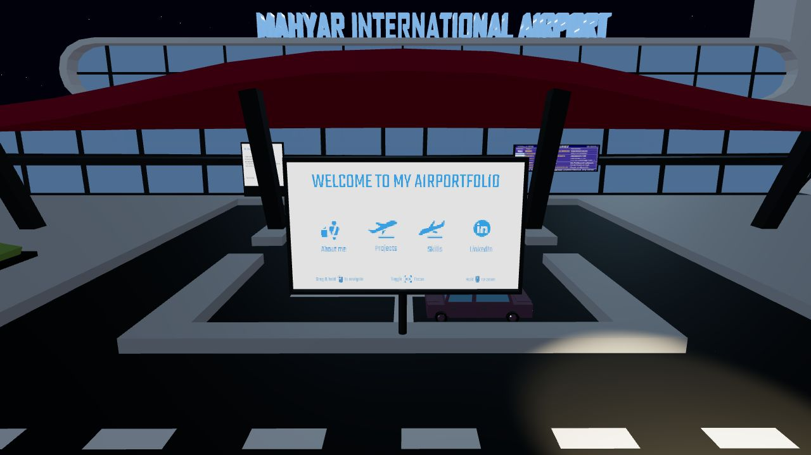
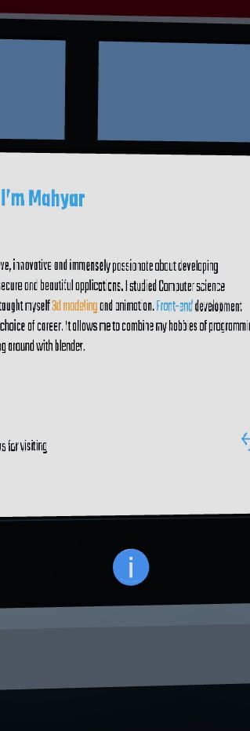
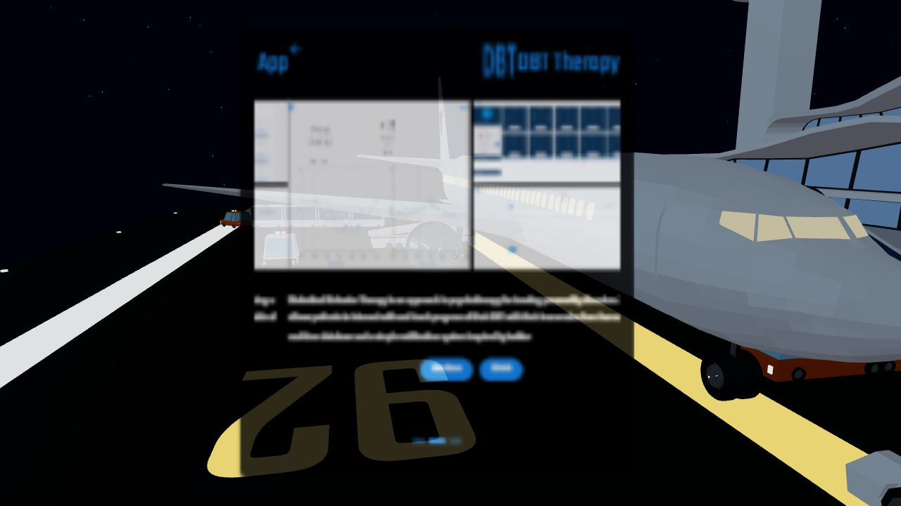
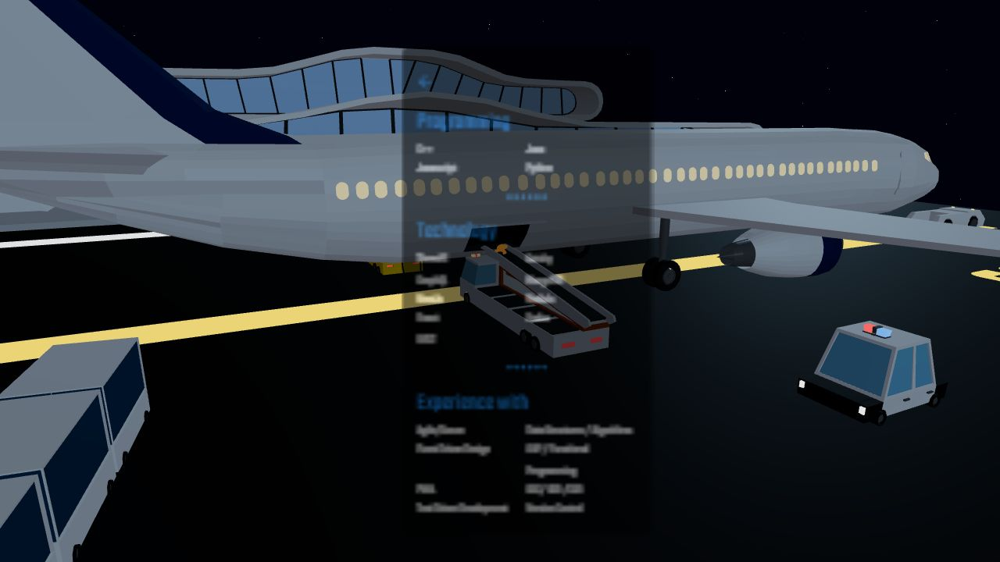
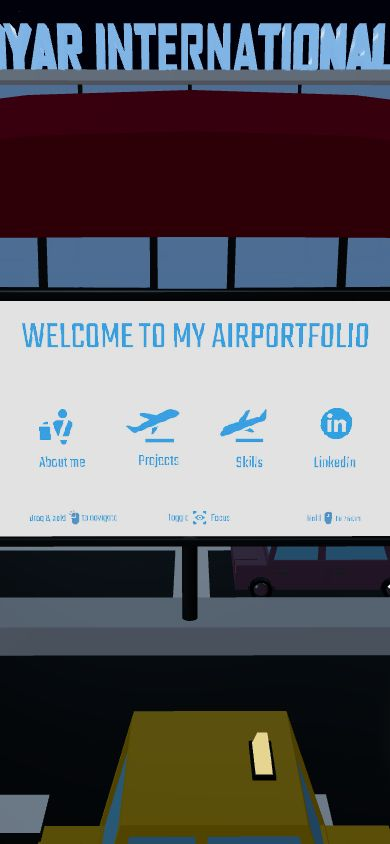
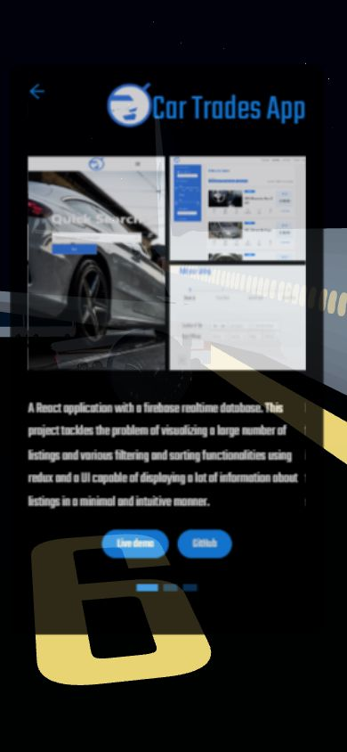

# Baseline results — 2026-10-29

Source baseline: `112d70e` (`changed site title`, 2022-10-18).
No commits, pushes or deployments were performed. Application source and locked dependency versions are unchanged.

## Environment and reproducibility

- Windows; Node 24.16.0; npm 11.13.0; Yarn Classic 1.22.22.
- Node pinned in `.nvmrc` and `package.json`; Yarn pinned in `packageManager` and `engines`.
- `npx --yes yarn@1.22.22 install --frozen-lockfile --non-interactive`: passed.
- Repeat install with the cached Yarn 1.22.22 executable and `--offline --frozen-lockfile --non-interactive`: passed, already up to date.
- A second npx invocation was cancelled while waiting for registry access in the restricted environment; the offline repeat above verified the installed state.
- `git diff --exit-code -- yarn.lock`: passed; no lockfile changes.
- Lockfile SHA-256: `6618CA454702669045993776561903A5491A2CA392D163C67243A39069FB7855`.
- `git diff --check`: passed.

The install reports existing peer warnings for Testing Library DOM, Babel plugins, TypeScript tooling and react-is. These were not resolved by changing baseline dependency versions.

## Build results

| Check | Result |
| --- | --- |
| Development server | Compiles and runs with warnings at http://127.0.0.1:3000 |
| Production build (`CI=false npm run build`) | Passes with eight existing lint warnings |
| Strict CI build (`CI=true npm run build`) | Fails because CRA treats those warnings as errors |
| GitHub Actions execution | Not run; nothing pushed |
| Firebase deployment | Not run |

The production output is in `build`. Reported gzip sizes: JavaScript 342.49 kB, CSS 67.91 kB. Static models/audio/images are additional payload. Production output has not been exercised in a hosted preview yet.

CI now installs from the existing Yarn lockfile using pinned Node/Yarn. **CI remains strict and is not yet green**: the existing lint issues must be fixed in step 2. `CI=false` was used only for the local baseline artifact build, not added to the workflow.

### Existing lint warnings

1. `src/App.js:6`: unused Stats import.
2. `src/App.js:7`: unused THREE import.
3. `src/components/intro/Intro.component.jsx:6`: missing setReady effect dependency.
4. `src/components/new-airport-scene/NewAirportScene.component.jsx:59`: missing actions/animationsList dependencies.
5. Same file, line 158: missing actions/animationsList dependencies.
6. Same file, line 264: unused angleToRadians.
7. `src/components/new-static-items/NewStaticItems.component.jsx:5`: unused animations.
8. `src/components/overlay/projects/Projects.component.jsx:4`: unused ItemContainer.

Additional tool warnings: outdated Browserslist data, deprecated Node fs.F_OK and old webpack-dev-server middleware hooks.

## Visual and interaction baseline

Checked in the in-app Chromium browser. Desktop captures use 1280×720; mobile viewport uses 390×844. Mobile viewport testing does not replace real touch-device testing. Animations make exact pixel comparisons nondeterministic.

| Interaction | Observation |
| --- | --- |
| Initial loading / Start | Start appears; click opens the airport scene |
| About | Camera moves to the About display |
| Escape from About | Returns to the main board |
| Projects | Project overlay appears |
| Carousel | Selecting dot 2 changes Car Trades to DBT Therapy |
| Back controls | Projects and Skills arrows return to main board |
| Skills | Overlay text and scene are rendered |
| Mobile home / Projects | Both render at 390×844; project/back controls respond |
| Orbit / zoom | Drag and scroll change camera view; subsequently observed return to main focus, requiring closer focus-toggle testing |
| Credits | Sign visible in orbit view, but attempted click did not establish Credits overlay; not verified |
| Audio / tab visibility | Audible correctness and background pause/resume not verified; needs a listening check |
| Browser errors | Captured dev-log query returned no error/warning entries; this is not a guarantee of full console coverage |

The project and skills overlays look soft/blurry and translucent in these captures. Preserve this observation for comparison; no styling changes were made. The initial Start view has low contrast. No automated test suite exists yet.

### Captures

## User review before proceeding

Open http://127.0.0.1:3000 and inspect the baseline, including Credits, free-camera focus behavior, audio activation, and tab switching. The development server is left running for review.

Step 1 has established the install/build evidence and visual baseline. Tommy visually reviewed the preview on 2026-10-29 and authorized committing and pushing this stage. Audio/Credits verification and the known strict-CI failures remain outstanding. Step 2 should address these before dependency migration.

All six saved screenshots above are referenced baseline evidence; no unused screenshots were found during cleanup. Future stages still require visual review and authorization before committing or pushing.
